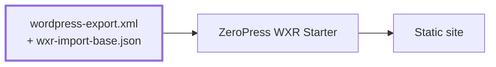

# ZeroPress WXR Starter

Turn your WordPress content into a static site you can make your own. Keep
publishing from WordPress, or bring an existing export and media backup—even if
the original site is no longer running. Both paths use this project's `theme/`
directory, which you can customize yourself or with an AI agent.

Start with the included Blog theme from `@zeropress/create-theme`. The sample has
eight posts, two pages, two authors, nested menus, category and monthly archives,
tables, code, and small bundled illustrations. Search, sidebar widgets, and light
and dark colors are ready to use.

> [!IMPORTANT]
> We recommend a private repository for your site's content and settings.
> On Cloudflare's setup page, select **Create private Git repository**.
> WordPress exports can include private data, such as commenters' email addresses.

[](https://deploy.workers.cloudflare.com/?url=https://github.com/zeropress-app/zeropress-starter-wxr/tree/latest)

## Publish your first site

Choose the path that matches your content. Both use the same build and hosting
setup:

| Your starting point | Guide |
| --- | --- |
| You want to keep writing in WordPress | [Publish from WordPress](#publish-from-wordpress) |
| You have a WXR export, including from a site that has closed | [Publish an existing export](#publish-an-existing-export) |

Use the **Deploy to Cloudflare** button above to create a private repository in
your GitHub account and deploy the sample. Keep the default commands:
`npm run build` and `npm run deploy`. Open the address provided by Cloudflare and
confirm that the sample site appears, then follow your chosen guide below.
You can also start with [Local preview](#local-preview) before setting up hosting.
After your first deployment, you can optionally
[format or minify the generated HTML](#optional-html-processing).

### Publish from WordPress

[ZeroPress Static](https://wordpress.org/plugins/zeropress-static/) is recommended
when you want to keep writing in WordPress and publish updates to GitHub.

1. **Connect WordPress.** Install and activate ZeroPress Static. Follow the
   plugin's [first-publication guide](https://github.com/zeropress-app/zeropress-static#first-publication-with-github-and-cloudflare)
   to enter the static site address, connect the new repository and publishing
   branch, and register a GitHub token. Continue when the connection test succeeds.
2. **Publish your content.** Make sure WordPress has at least one public,
   published post or page. Open **ZeroPress → Publish**, select
   **Prepare publishing data**, review the destination, then select
   **Publish to GitHub** and confirm.
3. **Check the live site.** Wait for Cloudflare's build and deployment to succeed,
   then refresh the site address. Your posts and images should replace the sample
   content. GitHub publication updates the repository; the connected build service
   performs the deployment.

After checking the site, enable **Allow search engine crawling** in the plugin's
Site settings if you want search engines to crawl it, then save, prepare, and
publish again. Comments and other optional features can be configured later.

For later updates, save your changes in WordPress, then prepare and publish from
**ZeroPress → Publish** or the editor's ZeroPress publish dialog.
Each publication replaces `wordpress-export.xml` and `wxr-import-base.json`.
Manage their content and settings in WordPress; direct edits to these files are
replaced on the next publication.

Keep lasting site-specific settings in
[`wxr-import-base.override.json`](#settings-that-survive-publication). The plugin
does not replace that file, and the starter applies it on every build.

Your changes to `theme/` and `public/` remain in the repository when you publish
new content. Each build regenerates the site in `dist/`, including removing
pages that are no longer published.

### Publish an existing export

Use this path with a saved WXR `.xml` file and any images or downloads the site
needs. With those files available and comments disabled, you do not need to
install or run WordPress, PHP, MySQL, or ZeroPress Static.

1. **Add your content.** Clone or download your site repository. Replace
   `wordpress-export.xml` at its root with your WXR file, keeping that filename.
   If you do not have an export yet and WordPress is still running, use
   **Tools → Export → All content** to create one.
2. **Restore public media.** WXR contains references to media, not the media
   files themselves. From your backup, copy the images and downloads needed by
   the site into `public/`, preserving their subdirectories. For example,
   `wp-content/uploads/2024/05/photo.jpg` becomes
   `public/wp-content/uploads/2024/05/photo.jpg` and is published at
   `/wp-content/uploads/2024/05/photo.jpg`. Include the image sizes referenced by
   the content, not just the originals. Copy only files intended for publication;
   WordPress plugins, themes, and database backups do not belong in `public/`.
3. **Set the site address and media locations.** Edit `wxr-import-base.json`
   using the example below. Replace the example addresses with your original
   WordPress address and new static site address. Keep any additional settings
   you already use. If the media is still available at its original URLs, you
   can keep those URLs and omit `import.media_rewrites`.
4. **Preview and check.** Follow [Local preview](#local-preview), then check posts,
   pages, images, downloads, menus, and links within the content. Links to old
   posts or pages are not automatically moved to the new domain. Update them
   where needed and check that their paths exist on the static site.
5. **Publish the restored site.** After reviewing the result, commit and push
   the source files and public media to the branch your hosting service builds.
   Wait for deployment to complete and check the live site.

This complete `wxr-import-base.json` example disables comments and serves the
backed-up media from the new site:

```json
{
  "$schema": "https://www.schemastore.org/zeropress-wxr-import-base-0.7.json",
  "version": "0.7",
  "site": {
    "url": "https://archive.example",
    "robots": { "allow_indexing": false }
  },
  "comments": {
    "enabled": false
  },
  "import": {
    "media_rewrites": [
      {
        "from": "https://old.example/wp-content/uploads/",
        "to": "https://archive.example/wp-content/uploads/"
      }
    ]
  }
}
```

Match `from` to the media URL prefix saved in your export, including `http` or
`https` and any subdirectory. Match `to` to where the copied files will be served.
Both prefixes must be absolute HTTP(S) URLs. Add a rule for each source prefix
if your export uses several. The starter rewrites matching URLs during import;
it does not fetch files from the old site.

Inline media keeps the absolute destination URL. To check restored images
locally before their destination is online, temporarily use the local preview's
address in `site.url` and the media rules' `to` values, keeping their paths.
Restore the hosted address before publishing.

With `comments.enabled: false`, no comment API address or running WordPress
server is needed. You can also keep this setting in the override file.

After checking the live site, set `site.robots.allow_indexing` to `true` if you
want search engines to crawl it, then rebuild and publish. You can keep the WXR
unchanged and [customize the design](#customize-your-site) whenever you like.
If you later have a newer export, replace the XML file and rebuild. Connecting
ZeroPress Static later makes the plugin responsible for both input files;
its publications replace them.

## Settings that survive publication

Edit `wxr-import-base.override.json` for settings that should stay in place when
ZeroPress Static publishes new content. It starts as `{}` and is read by
`npm run import`, `npm run build`, and local previews. For example:

```json
{
  "site": { "posts_per_page": 8 },
  "comments": { "enabled": false },
  "custom_css": { "content": ".site-title { letter-spacing: -0.02em; }" }
}
```

Only include values you want to override. Other settings continue to come from
the base file. These values take precedence even if you later change the same
settings in WordPress; remove the corresponding override to use WordPress again.
For a manual export, you may edit the base directly or use this same override.

Settings objects are merged by property. Widgets, collections, menu mappings,
and arrays are replaced in full, so provide the complete configuration you want
to keep. For example, `"widgets": {}` removes the sidebar widgets. `null` is not
a deletion instruction. No `$schema` or `version` is needed in this file.

Unknown setting names produce warnings and are ignored. Invalid values for
known settings stop the build, helping you catch changes that could not be
applied. Keep the file present, using `{}` when no overrides are needed.
See the importer's [override rules](https://github.com/zeropress-app/zeropress-wxr-import#override-settings)
for details. The override is a build input and is not copied to the public site.

## Customize your site

Clone or download your own site repository and follow [Local preview](#local-preview).
Edit the theme source files while viewing your own content in the browser.

| Change | Where to edit |
| --- | --- |
| Colors, spacing, and typography | `theme/assets/style.css` |
| Shared page layout | `theme/layout.html` |
| Header, footer, and reusable parts | `theme/partials/` |
| Home page and post lists | `theme/index.html`, `theme/archive.html`, `theme/category.html`, `theme/tag.html` |
| Individual posts and pages | `theme/post.html`, `theme/page.html` |
| Site-specific images and downloads | `public/` |
| Persistent site settings and custom CSS/HTML | `wxr-import-base.override.json` |

The [theme authoring guide](https://zeropress.dev/guides/theme-authoring/)
explains the template syntax and available data. Keep your content and settings
in WordPress when using the plugin, put lasting setting overrides in the override
file, and make layout changes in the theme.
Changes to `dist/` or `.zeropress-wxr/` are regenerated on the next build.

### Work with an AI agent

Give the agent access to your own site repository and ask it to read
[AGENTS.md](AGENTS.md). An agent that can edit files, run the build, and view the
local preview can check the result with your content. For example:

> Read AGENTS.md and restyle this site as a spacious, card-based magazine.
> Keep my content, page URLs, enabled search and comments, and publishing
> setup working. Check the home page, a post, and a page at desktop and mobile
> widths. Explain any tests that need to change with the design, and run the
> relevant checks. Leave the changes for my review before committing or deploying.

Review the changes with `npm run preview`, which includes the production search
build. Check menus, pagination, and any enabled search and comment features.
When you are satisfied, commit and push the source changes to the branch your
hosting service builds. With ZeroPress Static, future content updates come from
WordPress. With a saved export, design changes can reuse the same content and
media files.

## Build flow

Both workflows use `wordpress-export.xml` and `wxr-import-base.json` in the
repository root. `npm run build` imports these files and builds the site using
your theme.



## Media and links

- Images and downloads must be available at the URLs used in the generated
  site. They can remain on an existing media host or be copied into `public/`.
  ZeroPress Static can replace URLs before publication; manually managed exports
  can use `import.media_rewrites`. The starter does not download or move media.
- Links in post and page content keep their original URLs. They can lead back
  to the old site; media URL replacements are not a general migration of links
  to posts and pages. Generated post lists use static page URLs; check custom
  menu links for old addresses too.

For a site whose media host has closed, follow
[Publish an existing export](#publish-an-existing-export) to restore the files
and update their URLs. WordPress is not needed to serve media from the static site.

## Optional WordPress comments

Enable comments only if you have a running WordPress site to provide them.
Comments are read from its REST API using the original post or page ID.
Submitted comments go to WordPress and follow its moderation settings.
Comment records in the WXR file are not published.

When comments are enabled, keep the WordPress REST API publicly accessible.
The WordPress admin interface can remain private. The comment API must allow
requests from your new site's origin. With ZeroPress Static, configure
comment display and writing in the plugin; both start off. For a setup without
the plugin, WordPress needs to allow
[anonymous REST comments](https://developer.wordpress.org/reference/hooks/rest_allow_anonymous_comments/)
for visitors to submit from this site. The comment area explains request failures
without assuming a public WordPress page exists. No WordPress credentials are needed here.

The sample export has comments closed. With a manual export and the default base
settings, posts with open comments enable their comment areas automatically.
Having no comments in the export does not disable the comment feature. For a
site without a WordPress server, use the explicit disabled configuration in
[Publish an existing export](#publish-an-existing-export).
With ZeroPress Static, comment display follows the plugin's settings.

The Blog theme loads one page initially (50 comments by default, at most 100
per request). **Load more** fetches subsequent pages on demand. Existing comments
and reply drafts remain available if an additional request fails.
Requests have a timeout, and an uncertain submission is never automatically resent.

### ZeroPress Static comment writing policy

The blog theme supports the ZeroPress Static WordPress plugin's runtime writing
policy. With writing disabled, comments remain visible without a form or reply
buttons. Enabled writing uses the plugin's PoW or Cloudflare Turnstile setting.
Policy failures keep the list visible and offer a writing-options retry.

The blog theme uses these paths on the configured WordPress API host:

| Exact path | HTTP methods | Purpose |
| --- | --- | --- |
| `/wp-json/wp/v2/comments` | `GET`, `POST` | Read comments and submit comments or replies |
| `/wp-json/zeropress-static/v1/comments/policy` | `GET` | Read the comment-writing policy |
| `/wp-json/zeropress-static/v1/comments/challenge` | `POST` | Obtain comment-verification data before submission |

For access-control or proxy rules, match the API hostname and each exact
path/method pair. Query parameters such as `?post=123&page=2` are separate from
the path and must be preserved. For a subdirectory installation, include that
prefix in every path, for example `/blog/wp-json/wp/v2/comments`.

With comment writing disabled, the theme uses only the two `GET` requests.
Also allow `OPTIONS` on the corresponding paths when CORS preflight is needed.
Configure WAF exceptions separately, limiting them to security rules that block
legitimate comment requests.

WordPress front-end pages need not be public. The
`zeropress_client=theme-v1` submission marker identifies the integration rather
than proving who sent a request. Normal WordPress authentication, moderation and
closed-comment rules remain in force.

When WordPress explicitly reports that the policy route is missing, the theme
uses standard WordPress comment submission. Other policy errors do not enable
writing.
No build input or Preview Data changes are required for writing-policy updates.

## Scope

Published posts, pages, categories, tags, and menus are imported. Drafts, private
content, and password-protected posts are excluded. The site uses a ZeroPress
theme; the original WordPress theme is not restored. WordPress plugins,
shortcodes, and PHP-powered features do not run in the static site.

A saved export and available media are enough for a site without comments.
WordPress can remain your editor for ongoing publication, but is not required
to keep an archived site online or change its design.
If you later want to edit content with
[ZeroPress Studio](https://github.com/zeropress-app/zeropress-studio), you can
import the WXR there and use the [Studio Starter](https://github.com/zeropress-app/zeropress-starter-studio).

## Local preview

Use Node.js 22.22.0 or later; `.node-version` selects Node.js 24.

```sh
npm ci
npm run dev
```

The preview rebuilds when `wordpress-export.xml`, `wxr-import-base.json`,
`wxr-import-base.override.json`, `theme/`, or `public/` changes. A failed import
keeps the last successful preview.

| Command | Purpose |
| --- | --- |
| `npm run dev` | Watch the export, rebuild, and serve locally |
| `npm run build` | Convert WXR, build the site in `dist/`, and replace search with Pagefind |
| `npm run preview` | Build and preview the deployment output, including Pagefind |
| `npm run dist:preview` | Preview the existing `dist/` locally without rebuilding |
| `npm run dist:prettify` | Format the built HTML for easier reading |
| `npm run dist:minify` | Minify the built HTML and inline JavaScript |
| `npm run deploy` | Deploy the existing `dist/` |
| `npm run deploy:dry-run` | Build and validate deployment without uploading |
| `npm test` | Check importing, page generation, and comments |
| `npm run check` | Check configuration formatting, run tests, and build and validate deployment without uploading |
| `npm run format:wrangler` | Format `wrangler.jsonc` |

`npm run check` runs `format:wrangler:check`, `test`, and `deploy:dry-run`
in order. The dry run rebuilds the site in `dist/`.

Site information and the comment API address come from the export and base
settings. The bundled sample `wxr-import-base.json` disallows crawling and leaves
the new site URL empty, so no domain setup is required for local preview.
Generated Preview Data is written to
`.zeropress-wxr/zeropress-preview-data.json`, outside the published files, and is
excluded from Git.

## Blog settings

When using ZeroPress Static, manage site settings through **ZeroPress → Settings**
and publish them with your content. The plugin regenerates `wxr-import-base.json`
on each publication. To hide or rearrange the sidebar, edit the theme templates
that render it.

The direct base-file edits below apply to
[manually managed exports](#publish-an-existing-export), including archived sites.
`wxr-import-base.json` controls import settings without editing the WXR file.
The bundled defaults enable search and monthly archives and show five posts per
listing page. Site information and content are read from the WXR, with overrides
from the base settings where supported.

The sidebar lists recent posts, categories, tags, and archives from each import.
No sample profile or sample article links are added to your own export. To hide
the sidebar widgets, add `"widgets": {}` at the top level of the base file. To
customize them, start with the `widgets` object in the generated
`.zeropress-wxr/zeropress-preview-data.json` and copy it into your base file.

The header displays the imported `primary` menu with up to three levels; the
footer displays one level. Deeper items remain in Preview Data but are omitted
from the rendered navigation with a build warning. When WordPress is available,
edit its menus and export again. With a saved export, select imported menus using
`import.menu_mapping` below, or customize the theme's navigation markup.
An export without menus still has the home link, search, and content-based sidebar.

Edit `theme/` for layout and colors. The initial Blog theme is shared with
`@zeropress/create-theme` and Studio Starter, and supports both
WordPress and ZeroPress Edge comments. This starter selects WordPress through
its imported data; it does not set up Edge.
The illustrations in `public/demo/` are only for the included sample articles;
you can remove them after replacing the sample export. Media URL rewriting is
configured separately through `import.media_rewrites`; media files are not downloaded.

For a manual export, set `site.url` in the base file to your static site's
origin to enable canonical URLs and the sitemap. Crawling remains disabled
until you explicitly set `site.robots.allow_indexing` to `true`.

For explicit selection, set `import.menu_mapping` in `wxr-import-base.json`:

```json
{
  "import": {
    "menu_mapping": { "primary": "20", "footer": "21" }
  }
}
```

Values are classic WordPress `nav_menu` term IDs (`wp:term_id`) as strings. Use
IDs from your export, not the sample IDs above. Omit the mapping to let the
importer infer menu IDs; use `{}` to select none. Explicit selection emits only
those slots. Custom IDs work when the theme renders them. ZeroPress Static
manages this mapping through its menu settings and exports only selected menus.

For manually managed exports needing media relocation, use `import.media_rewrites`
as shown in [Publish an existing export](#publish-an-existing-export).
Longest prefixes win once, and `[]` disables inference and rewriting.
ZeroPress Static performs its media replacements before export, so no additional
importer rules are needed for plugin-generated files.

## RSS feed

With ZeroPress Static, configure the static site URL and enable RSS feed
generation in the plugin settings, then publish again. For manual exports, set
`site.url` to your static site's origin and keep `site.feed.enabled` enabled
to generate `/feed.xml`.

The included `public/_redirects` redirects `/feed`, `/feed/`, `/rss`, and `/rss/`
to `/feed.xml` with HTTP 301.
Feed readers can continue using these addresses when your static site takes over
the same domain.

ZeroPress does not support comment feeds.

## Search

Local development uses ZeroPress's built-in search. Production builds use
[Pagefind](https://pagefind.app/) with the Blog theme's existing search dialog.
Use `npm run preview` to check Pagefind locally.

After WXR import and the site build, `postbuild` runs
`search:replace-with-pagefind`. It generates `dist/_zeropress/pagefind/`, replaces
`search.js` with the generated Pagefind adapter, and removes the unused
`search.json`. Pagefind is installed with the project; no search service or API
token is needed. If indexing fails, the build fails before adapter replacement.

Pagefind indexes the marked content of published posts and pages, excluding
navigation, sidebar text, and comments. Drafts and password-protected posts
are not published or indexed. Pagefind uses its own ranking and language handling.

With ZeroPress Static, turn off **Enable search** in the plugin settings and
publish again to disable search and skip Pagefind. For manual exports, set
`site.search.enabled` to `false` in `wxr-import-base.json`.
An export without searchable content keeps an empty native index.
To keep built-in search in production, remove `postbuild` from
`package.json` and rebuild. You can also remove `search:replace-with-pagefind`,
its script, and the Pagefind dependency if you no longer use them.

## Optional HTML processing

Choose an optional output format for the HTML generated in `dist/`:

| Goal | Command | Effect |
| --- | --- | --- |
| Read the generated HTML more easily | `npm run dist:prettify` | Format HTML with Prettier |
| Publish smaller HTML files | `npm run dist:minify` | Reduce whitespace, remove comments, and minify inline JavaScript |

Run one of these commands after `npm run build`. Minification includes JavaScript
inside `<script>` elements and event attributes such as `onclick`. Only HTML
files are processed; separate JavaScript files, CSS, and Pagefind assets remain
unchanged.

These commands are optional and do not run during the default build. Their tool
versions and options are fixed in `scripts/prettify.mjs` and `scripts/minify.mjs`;
npm downloads the tools when needed.

### Preview processed HTML locally

For minified HTML:

```sh
npm run build && npm run dist:minify
npm run dist:preview
```

For formatted HTML:

```sh
npm run build && npm run dist:prettify
npm run dist:preview
```

`dist:preview` serves the processed files already in `dist/`. Use it to check
the result before publishing. Running `preview`, `check`, or another build
regenerates `dist/` and replaces the processed HTML.

### Apply processing to Cloudflare builds

In your Worker's **Builds → Production** settings, find **Build configuration**
and choose the commands for the output you want:

| Output | Build command | Deploy command |
| --- | --- | --- |
| Default HTML | `npm run build` | `npm run deploy` |
| Minified HTML | `npm run build && npm run dist:minify` | `npm run deploy` |
| Formatted HTML | `npm run build && npm run dist:prettify` | `npm run deploy` |

For this starter at the repository root, keep **Root directory** set to `/`.
Keep **Production branch** set to the branch you publish to, such as `main`.
Save the configuration and start a new build to apply it to the live site.

The build command generates the site, including its Pagefind search index when
enabled, before processing the HTML. The deploy command uploads that `dist/` without
rebuilding it. Put the formatting or minification step in **Build command** and
keep **Deploy command** as `npm run deploy`.

To return to the default output, set **Build command** back to `npm run build`.

## License

MIT
