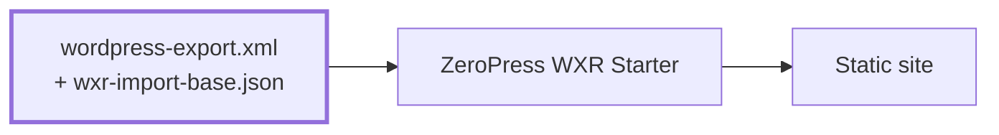

# ZeroPress WXR Starter

Try ZeroPress with an export from your WordPress site. Your posts and pages become
a static site using the Blog theme from `@zeropress/create-theme`; your images
and comments stay on WordPress.

The included sample has eight posts, two pages, two authors, nested menus,
category and monthly archives, tables, code, and small bundled illustrations.
Search, sidebar widgets, and light and dark colors are ready to use.

> [!IMPORTANT]
> We recommend a private repository for your site's content and settings.
> On Cloudflare's setup page, select **Create private Git repository**.
> WordPress exports can include private data, such as commenters' email addresses.

[](https://deploy.workers.cloudflare.com/?url=https://github.com/zeropress-app/zeropress-starter-wxr/tree/latest)

## Build flow

Place `wordpress-export.xml` and `wxr-import-base.json` in the repository root,
then run `npm run build`.



## Try your WordPress content

1. Use the button to create a repository and deploy the included sample site.
   Keep the default commands: `npm run build` and `npm run deploy`.
2. In WordPress, open **Tools → Export**, choose **All content**, and download
   the WXR `.xml` file.
3. Replace `wordpress-export.xml` at the repository root with your export,
   keeping that filename. Commit and push to rebuild your site.

To refresh the site later, replace the same XML file with a new export and push.
Each build replaces the previous generated site, including removing old pages.

## What stays on WordPress

- Images are loaded from their existing URLs. No media files are downloaded or moved.
- Links in post and page content keep their original URLs. They can lead back
  to WordPress; the generated post lists and navigation open the static pages.
- Comments are read from the WordPress REST API using the original post or page
  ID. Submitted comments go to WordPress and follow its moderation settings.
  Comment records in the WXR file are not published.

Keep the media URLs and, when comments are enabled, the WordPress REST API publicly
accessible. The WordPress admin interface can remain private. The comment API must
allow requests from your new site's origin. WordPress also needs to allow
[anonymous REST comments](https://developer.wordpress.org/reference/hooks/rest_allow_anonymous_comments/)
for visitors to submit from this site. The comment area explains request failures
without assuming a public WordPress page exists. No WordPress credentials are needed here.

The sample export has comments closed. Replacing it with an export containing
posts with open comments enables their comment areas automatically.

The Blog theme loads one page initially (50 comments by default, at most 100
per request). **Load more** fetches subsequent pages on demand. Existing comments
and reply drafts remain available if an additional request fails.
Requests have a timeout, and an uncertain submission is never automatically resent.

### ZeroPress Static comment writing policy

The blog theme supports the ZeroPress Static WordPress plugin's runtime writing
policy. With writing disabled, comments remain visible without a form or reply
buttons. Enabled writing uses the plugin's PoW or Cloudflare Turnstile setting.
Policy failures keep the list visible and offer a writing-options retry.

The blog theme uses these paths on the configured WordPress API host:

| Exact path | HTTP methods | Purpose |
| --- | --- | --- |
| `/wp-json/wp/v2/comments` | `GET`, `POST` | Read comments and submit comments or replies |
| `/wp-json/zeropress-static/v1/comments/policy` | `GET` | Read the comment-writing policy |
| `/wp-json/zeropress-static/v1/comments/challenge` | `POST` | Obtain comment-verification data before submission |

For access-control or proxy rules, match the API hostname and each exact
path/method pair. Query parameters such as `?post=123&page=2` are separate from
the path and must be preserved. For a subdirectory installation, include that
prefix in every path, for example `/blog/wp-json/wp/v2/comments`.

With comment writing disabled, the theme uses only the two `GET` requests.
Also allow `OPTIONS` on the corresponding paths when CORS preflight is needed.
Configure WAF exceptions separately, limiting them to security rules that block
legitimate comment requests.

WordPress front-end pages need not be public. The
`zeropress_client=theme-v1` submission marker identifies the integration rather
than proving who sent a request. Normal WordPress authentication, moderation and
closed-comment rules remain in force.

When WordPress explicitly reports that the policy route is missing, the theme
uses standard WordPress comment submission. Other policy errors do not enable
writing.
No build input or Preview Data changes are required for writing-policy updates.

## Scope

Published posts, pages, categories, tags, and menus are imported. Drafts, private
content, and password-protected posts are excluded. WordPress plugins, shortcodes,
and PHP-powered features do not run in the static site.

This is a quick trial that continues to depend on WordPress. For a full move,
import your WXR into [ZeroPress Studio](https://github.com/zeropress-app/zeropress-studio)
and publish to a separate [Studio Starter](https://github.com/zeropress-app/zeropress-starter-studio)
repository.

## Local preview

Use Node.js 22.22.0 or later; `.node-version` selects Node.js 24.

```sh
npm ci
npm run dev
```

The preview rebuilds when `wordpress-export.xml`, `wxr-import-base.json`, `theme/`,
or `public/` changes. A failed import keeps the last successful preview.

| Command | Purpose |
| --- | --- |
| `npm run dev` | Watch the export, rebuild, and serve locally |
| `npm run build` | Convert WXR, build the site in `dist/`, and replace search with Pagefind |
| `npm run preview` | Build and preview the deployment output, including Pagefind |
| `npm run deploy` | Deploy the existing `dist/` |
| `npm run deploy:dry-run` | Build and validate deployment without uploading |
| `npm test` | Check importing, page generation, and comments |
| `npm run format:wrangler` | Format `wrangler.jsonc` |

Site information and the comment API address are inferred from the export.
`wxr-import-base.json` disallows crawling by default and leaves the new site URL
empty, so no domain setup is required. Generated Preview Data is written to
`.zeropress-wxr/zeropress-preview-data.json`, outside the published files, and is
excluded from Git.

## Blog settings

`wxr-import-base.json` controls presentation without editing the imported
content. The defaults enable search and monthly archives and show five posts
per listing page. The title, description, language, authors, and content still
come from your WXR file.

The sidebar lists recent posts, categories, tags, and archives from each import.
No sample profile or sample article links are added to your own export. To hide
the sidebar widgets, add `"widgets": {}` at the top level of the base file. To
customize them, start with the `widgets` object in the generated
`.zeropress-wxr/zeropress-preview-data.json` and copy it into your base file.

The header displays the imported `primary` menu with up to three levels; the
footer displays one level. Deeper items remain in Preview Data but are omitted
from the rendered navigation with a build warning. Edit menus in WordPress and
export again. An export without menus still has the home link, search, and
content-based sidebar.

Edit `theme/` for layout and colors. The bundled Blog theme is identical to
the one in `@zeropress/create-theme` and Studio Starter, and supports both
WordPress and ZeroPress Edge comments. This starter selects WordPress through
its imported data; it does not set up Edge.
The illustrations in `public/demo/` are only for the included sample articles;
you can remove them after replacing the sample export. Media URL rewriting is
configured separately through `import.media_rewrites`; media files are not downloaded.

If you give the preview its own domain, set `site.url` in the base file to that
origin to enable canonical URLs and the sitemap. Crawling remains disabled
until you explicitly set `site.robots.allow_indexing` to `true`.

For explicit selection, set `import.menu_mapping` in `wxr-import-base.json`:

```json
{
  "import": {
    "menu_mapping": { "primary": "20", "footer": "21" }
  }
}
```

Values are classic WordPress `nav_menu` term IDs (`wp:term_id`) as strings. Use
IDs from your export, not the sample IDs above. Omit the mapping to let the
importer infer menu IDs; use `{}` to select none. Explicit selection emits only
those slots. Custom IDs work when the theme renders them. ZeroPress Static
manages this mapping through its menu settings and exports only selected menus.

For command-line imports needing media relocation, use `import.media_rewrites`
with `{ "from": "https://old.example/uploads/", "to": "https://media.example/uploads/" }`
objects. Longest prefixes win once, and `[]` disables inference and rewriting.
ZeroPress Static performs its media replacements before export, so no additional
importer rules are needed for plugin-generated files.

## Search

Local development uses ZeroPress's built-in search. Production builds use
[Pagefind](https://pagefind.app/) with the Blog theme's existing search dialog.
Use `npm run preview` to check Pagefind locally.

After WXR import and the site build, `postbuild` runs
`search:replace-with-pagefind`. It generates `dist/_zeropress/pagefind/`, replaces
`search.js` with the generated Pagefind adapter, and removes the unused
`search.json`. Pagefind is installed with the project; no search service or API
token is needed. If indexing fails, the build fails before adapter replacement.

Pagefind indexes the marked content of published posts and pages, excluding
navigation, sidebar text, and comments. Drafts and password-protected posts
are not published or indexed. Pagefind uses its own ranking and language handling.

Set `site.search.enabled` to `false` in `wxr-import-base.json` to disable search
and skip Pagefind. An export without searchable content keeps an empty native
index. To keep built-in search in production, remove `postbuild` from
`package.json` and rebuild. You can also remove `search:replace-with-pagefind`,
its script, and the Pagefind dependency if you no longer use them.

## License

MIT
